# Analisis 5 Lineup Magic Chess: Go Go — Season 7 "Chrono Echoes"

Versi game 1.3.24.344.1 · dibuat 20 Oktober 2026, diperbarui 21 Oktober 2026 (Penyesuaian 20/10) dari data game (S7.json) · gambar dari file game (folder `img/`)

## Kesimpulan

- **Terkuat tanpa ultra:** 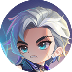 Aamon — Dauntless 6 + Stargazer 4 + Mistbender 3. Sinerginya sudah maksimal tanpa ultra, dan tim terus menguat lewat Spirit Sand.
- **Damage tim tertinggi di mid game:** 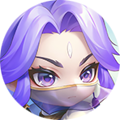 Luo Yi — Starbelle 6 dengan Odette ★2 sebagai Fan (setiap hero Starbelle sekitar +401 ATK).
- **Paling konsisten:**  Kagura — Kishin 6 + Phasewarper 3 + Shadeweaver 3. Item Arcane didapat dengan Gold, bukan hoki.

### Peringkat tanpa ultra

| # | Lineup | Commander | Crystal wajib | Level | Konsistensi | Puncak (dengan ultra) |
|---|---|---|---|---|---|---|
| 1 | Dauntless 6 + Stargazer 4 + Mistbender 3 |  Aamon | 1 (crystal Pilihan) | 10 (di level 9: Stargazer 2) | Sedang | Sangat tinggi tanpa ultra |
| 2 | Starbelle 6 + Astro 4 |  Luo Yi | 1 (crystal Pilihan atau Starbelle's Badge) | 9 | Sedang–tinggi (2 hero 5 Gold ★2) | Tinggi; Starbelle 10 menaikkan bonus Fan ke 100% |
| 3 | Kishin 6 + Phasewarper 3 + Shadeweaver 3 |  Kagura | 1 (crystal Pilihan) atau Dyrroth | 9 | Tinggi | Sangat tinggi di Kishin 10 (item Supreme) |
| 4 | Astro 6 + Mage 4 | 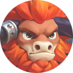 Minotaur | 1 (crystal Pilihan); +2 dari kartu untuk sinergi pengisi | 9 | Tinggi | Tinggi; Astro 10 memberi 2 Sovereign |
| 5 | Dragon Altar 6 + Dragoncaller 4 |  Kalea | 1 (crystal Pilihan); +1 dari kartu untuk Defender 2 | 9 | Sedang | Sangat tinggi di Dragoncaller 10 |

_Selisih kekuatan #2 sampai #4 kecil; pilihannya lebih ditentukan hero yang sedang banyak diambil pemain lain._

## Dampak Penyesuaian Keseimbangan 20/10

_Patch note server 20 Oktober (dicatat di server_patch.json; angka di bawah dibaca dari S7.json). Peringkat tidak berubah: #1–#4 hanya kena nerf kecil Lunox atau tidak terdampak, sedangkan #5 (Kalea) makin tertinggal karena carry-nya dinerf._

- **Nerf terbesar untuk lineup-mu** — 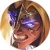 **Badang** (carry ★2; Lineup: #5 Kalea): Peluang meninju balik saat menerima DMG 50% → 25% (semua bintang). Di ★2 satu tinju balik = 90% ATK ≈ 288 Physical DMG, jadi rata-rata DMG balasan per serangan yang diterima turun dari ±144 ke ±72. HP, DEF, dan skill aktif Fist Crack (8 Fist Wind × 50% ATK) tidak berubah: Badang ★2 tetap tebal, tapi damage-nya turun. Pengali ★3 naik 420% → 800%, tapi ★3 butuh seluruh 9 stok hero 5 Gold.
- **Nerf kecil** —  **Lunox** (pengisi; Lineup: #1 Aamon, #3 Kagura): Hybrid ATK ★2 200 → 185 (−7,5%), jadi 3 Chaos Assault (500% Total Magic ATK di ★2) ikut turun ±7,5%. Di kedua lineup Lunox hanya pengisi (Stargazer di Aamon, Kishin di Kagura); jumlah sinerginya tetap.
- **Buff, hanya di ★3** — 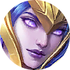 **Irithel** (pengisi; Lineup: #2 Luo Yi, #4 Minotaur): Batas Mana ★3 100 → 90: skill Strafe lebih cepat keluar, tapi hanya di ★3. Di kedua lineup Irithel pengisi Astro ★1/★2 tanpa item, jadi tidak berpengaruh.
- **Buff commander, bukan hero** —  **Vexana** (Commander; Tidak dipakai di 5 lineup): Hero Vexana di lineup Minotaur tidak berubah. Yang di-buff commander Vexana: 13 Gold di babak Go Go Box pertama → 10 Gold di tiap 3 babak Go Go Box pertama (total 30 Gold, +17 Gold), di samping hadiah ekstra I Want All of Them! di 3 Go Go Box itu. Jadi Vexana kini commander ekonomi awal yang kuat. Catatan: di file game 13 Gold ada di skill Lv 2 "Unrestricted", jadi bonus ini kemungkinan baru aktif setelah Vexana naik level itu (belum dicek in-game).

_Tidak berdampak ke 5 lineup ini: Layla (hero), Novaria (hero), Thamuz (hero), Layla (commander), Johnson (commander), Lukas (commander), Echomancer (sinergi), Turret of Guardians (Go Go Card)._

## Mekanik penting: crystal, stok, dan peluang

- Magic Crystal Pilihan: 1 crystal didapat saat masuk Fase Ⅱ, Ⅲ, dan Ⅳ, tetapi hanya 1 yang bisa aktif. Memakai crystal Pilihan berikutnya akan menggantikan yang lama, jadi crystal Pilihan hanya menambah +1 sinergi. (Aturan ini dari pengalaman bermain; tidak tertulis di tabel data.)
- Saat dipasang, 2 dari 3 pilihan crystal Pilihan selalu sinergi Faction dan Role hero itu sendiri; pilihan ke-3 acak dan tidak termasuk sinergi kecil (maksimal ≤ 4). Crystal Pilihan berikutnya berguna untuk pindah sinergi kalau rencana berubah.
- Crystal sinergi milik hero itu sendiri tetap menambah +1. Terbukti di pertandinganmu 20 Oktober: panel Astro 6/10 dengan 5 hero Astro + crystal Astro di Irithel.
- Crystal biasa (satu per hero, bisa banyak) hanya dari sumber acak: kartu Badge/Blessing sinergi, Legacy of Valor, Prime Selection, crystal Faction dari creep IV-3 (Patch 7.2), Peti Magic Crystal, Blessing commander Lunox, dan Go Go Box mulai akhir Fase Ⅱ (MCRoundRandomEquip_S7: 1–2 crystal sinergi acak di II-6, 2 di III-6, 3–4 mulai IV-6; terlihat di pertandingan 21 Oktober).
- Ultra 10 untuk faksi berisi 6 hero = 6 hero + 1 crystal Pilihan + 3 crystal biasa. Ketiga crystal biasa itu butuh hoki; karena itu jalur kartu rekomendasi game banyak mengambil kartu Badge/Blessing.
- Hero ★3 butuh 9 salinan. Stok pool bersama per harga: 1 Gold = 25, 2 Gold = 21, 3 Gold = 18, 4 Gold = 14, 5 Gold = 9. Hero 5 Gold ★3 berarti mengambil seluruh stok, kecuali punya Mirror Device.
- Peluang toko di level 9: 1 Gold 13%, 2 Gold 22%, 3 Gold 25%, 4 Gold 26%, 5 Gold 14%.

---

## #1 Dauntless 6 + Stargazer 4 + Mistbender 3 — Aamon

*Label in-game: tanpa label tier.*  Dauntless 6  Stargazer 4  Mistbender 3 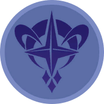 Astro Power 2  Kishin 2

**Paling kuat tanpa ultra: sinergi utamanya memang tidak punya tingkat 10, dan kekuatannya terus bertambah lewat Spirit Sand.**

### Posisi papan

| K1 | K2 | K3 | K4 | K5 | K6 | K7 |
|---|---|---|---|---|---|---|
| 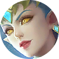 Karina |  Lolita **T ★★** | 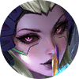 Alice |  Franco |  Hilda |  Aldous | 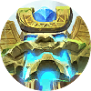 Uranus |
|   |   |   |   |   |   |   |
|   |   |  Mathilda |  Nana **C ★★★** |  Lunox |   |   |

_C = carry, T = tank (target bintang dari layar Rekomendasi Lineup)._

### Commander  Aamon (Strategi)

- **Lv 1+ Pasif: Blade of Resonance** — Mendapatkan 1 Mirror Device pada awal pertandingan. Saat Hero mencapai Bintang 2, kamu akan mendapatkan 1 Shard. 7 Shard akan otomatis dikonversi menjadi 1 Mirror Device. Kamu bisa mendapatkan hingga 2 Mirror Device.
- **Lv 2+ Pasif: Skybreaker Blade** — Mendapatkan 12 Gold tambahan setiap kali Mirror Device dibuat.
- **Kartu Power:** Mendapatkan 4 Gold setiap kali Hero mencapai Bintang 2 (hingga total 20 Gold).

### Hero

| Hero | Harga | Sinergi | Peran |
|---|---|---|---|
|  **Karina** | 3 Gold | Astro Power, Swiftblade, Stargazer |  |
|  **Lolita** | 4 Gold | Starbelle, Dauntless | T ★★ |
|  **Alice** | 5 Gold | SPECTRE, Dauntless |  |
|  **Franco** | 3 Gold | Kishin, Dauntless, Weapon Master |  |
|  **Hilda** | 3 Gold | Astro Power, Dauntless |  |
|  **Aldous** | 3 Gold | Mistbender, Bruiser |  |
|  **Uranus** | 1 Gold | Mistbender, Dauntless |  |
|  **Mathilda** | 3 Gold | Enchanted Tales, Stargazer |  |
|  **Nana** | 5 Gold | Mistbender, Stargazer | C ★★★ |
|  **Lunox** | 4 Gold | Kishin, Stargazer |  |

### Sinergi aktif

| Sinergi | Jumlah | Tingkat aktif | Efek (data game) |
|---|---|---|---|
|  **Dauntless** | 6 (+1 crystal) | 6 (maks) | Semua rekan mendapatkan Shield sebesar 20% Max HP. Hero Dauntless mendapatkan Shield tambahan sebesar 85% Max HP. |
|  **Stargazer** | 4 | 4 → 6 | Semua rekan memulihkan 4 Mana setiap detik. Hero Stargazer memulihkan 12 Mana tambahan setiap detik. |
|  **Mistbender** | 3 | 3 (maks) | Mendapatkan 2 Spirit Sand setelah menggunakan skill. |
|  **Astro Power** | 2 | 2 → 4 | Mendapatkan 10% Peningkatan DMG. Astro Sovereign mendapatkan 20% Peningkatan DMG dan 5% Hybrid Lifesteal tambahan. |
|  **Kishin** | 2 | 2 → 4 | Mendapatkan 1 Equipment Kishin. Hero Kishin mendapatkan 12 Hybrid DEF. |

### Go Go Card

 Aamon's Power ›  Payday › 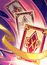 Jump the Gun+

- **Aamon's Power** (Power): Mendapatkan 4 Gold setiap kali Hero mencapai Bintang 2 (hingga total 20 Gold).
- **Payday** (Ungu): Mendapatkan 7 Gold secara langsung dan 7 Gold pada setiap babak untuk 2 babak berikutnya.
- **Jump the Gun+** (Biru): Mendapatkan 11 EXP Commander.

### Kenapa kuat

- Dauntless 6 (tingkat maksimal): semua rekan Shield 20% Max HP, hero Dauntless Shield tambahan 85% Max HP.
- Stargazer 4: hero Stargazer memulihkan 16 Mana per detik, jadi Nana, Lunox, Mathilda, dan Karina sering memakai skill.
- Mistbender 3: Aldous, Uranus, dan Nana menghasilkan 2 Spirit Sand setiap memakai skill. Di Toko Spirit Sand, Sand bisa dibelikan buff ATK/HP permanen seluruh tim (8/16/24 Sand → +1%/+3%/+5% ATK), Nana (60 Sand), atau Mirror Device (80 Sand).
- Aamon: 1 Mirror Device di awal dan hingga 2 lagi dari Shard ★2 (+12 Gold tiap Mirror Device). Kartu Power: 4 Gold setiap hero naik ★2 (maks 20).
- Karena itu Nana ★3 realistis: skill 2000% + 1100% ATK Magic DMG, HP 44.205.

### Kelemahan

- Butuh level 10 (10 hero). Versi level 9 ada di bawah.
- Lemah di awal game; kekuatannya baru terasa setelah Sand dan Mirror Device terkumpul.
- Karina, Hilda, dan Mathilda sering diperebutkan (Karina dan Mathilda dinerf di Patch 7.2). Nana 5 Gold hanya 9 stok.
- Lunox ★2 dinerf kecil di Penyesuaian 20/10 (Hybrid ATK 200 → 185); perannya sebagai pengisi Stargazer tetap.

### Tips

- Pasang crystal Pilihan ke hero Dauntless (pilihan Dauntless pasti muncul) dan jangan diganti: crystal Pilihan berikutnya akan menggantikan yang lama.
- Di Toko Spirit Sand, item ATK 24 Sand paling efisien (+5% untuk 24 Sand). Angka ini belum dicek ke screenshot toko.
- Simpan Mirror Device untuk Nana.

### Versi level 9 (9 hero, cukup 1 crystal Pilihan)

 Karina  Lolita  Alice  Franco  Hilda  Uranus  Aldous  Nana  Lunox

_Mathilda dikeluarkan, jadi Stargazer turun ke 3 (tingkat 2). Kalau dapat kartu Stargazer's Badge/Blessing, pasang crystal Stargazer-nya ke hero mana pun untuk kembali ke Stargazer 4._

| Sinergi | Jumlah | Tingkat aktif | Efek (data game) |
|---|---|---|---|
|  **Dauntless** | 6 (+1 crystal) | 6 (maks) | Semua rekan mendapatkan Shield sebesar 20% Max HP. Hero Dauntless mendapatkan Shield tambahan sebesar 85% Max HP. |
|  **Mistbender** | 3 | 3 (maks) | Mendapatkan 2 Spirit Sand setelah menggunakan skill. |
|  **Astro Power** | 2 | 2 → 4 | Mendapatkan 10% Peningkatan DMG. Astro Sovereign mendapatkan 20% Peningkatan DMG dan 5% Hybrid Lifesteal tambahan. |
|  **Kishin** | 2 | 2 → 4 | Mendapatkan 1 Equipment Kishin. Hero Kishin mendapatkan 12 Hybrid DEF. |
|  **Stargazer** | 3 | 2 → 4 | Semua rekan memulihkan 2 Mana setiap detik. Hero Stargazer memulihkan 6 Mana tambahan setiap detik. |

**Crystal yang dibutuhkan (tanpa ultra):** 1 crystal (Dauntless) dari crystal Pilihan. Di level 9, Stargazer 4 butuh 1 crystal lagi dari kartu (acak).

**Jalur ultra (opsional):** Tidak perlu: Dauntless (maks 6) dan Mistbender (maks 3) sudah di tingkat tertingginya. Stargazer bisa ke 6 dengan 2 crystal Stargazer dari kartu Badge/Blessing.

---

## #2 Starbelle 6 + Astro 4 — Luo Yi

*Label in-game: S.*  Starbelle 6  Astro Power 4  Dauntless 2  Mage 2 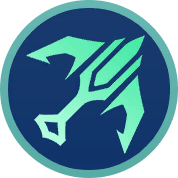 Marksman 2  Swiftblade 2

**Damage tim tertinggi di mid game: setiap tambahan ATK Odette ikut dibagi ke seluruh hero Starbelle lewat Lightstick.**

### Posisi papan

| K1 | K2 | K3 | K4 | K5 | K6 | K7 |
|---|---|---|---|---|---|---|
|   |  Fanny |  Hilda |  Edith |  Karina |  Lolita **T ★★★** |   |
|   |   |   |  Odette **C** |   |   |   |
|   |  Miya |   |  Irithel |   |  Zhuxin |   |

_C = carry, T = tank (target bintang dari layar Rekomendasi Lineup)._

### Commander  Luo Yi (Pertarungan)

- **Lv 1+ Pasif: Duality Transformation** — Memanggil perangkat di sisi chessboard. Menyeret Hero ke perangkat akan mengubah kekuatannya menjadi Equipment, Essence Core. Essence Core mewarisi sebagian atribut Hero. Reset perangkat untuk mengubah kembali Essence Core menjadi Hero. Essence Core mewarisi 40% dari Hybrid ATK dan HP Hero, serta 40% dari atribut dasar Equipment Hero. Jika Hero dengan efek Blessing diubah, Sinergi dari Blessing tetap dihitung, tapi pembawa Essence Core tidak akan mendapatkan efek Blessing.
- **Lv 2+ Pasif: Harmony of Essence** — Berdasarkan Sinergi Role dari Hero yang memberikan kekuatan, Essence Core mendapatkan efek penguatan tambahan: Efek Penguatan
- **Kartu Power:** Langsung mendapatkan 1 Hero 3 Gold acak, lalu mendapatkan 1 Hero yang sama pada setiap awal babak, hingga total 6.

### Hero

| Hero | Harga | Sinergi | Peran |
|---|---|---|---|
|  **Fanny** | 5 Gold | Starbelle, Swiftblade |  |
|  **Hilda** | 3 Gold | Astro Power, Dauntless |  |
|  **Edith** | 3 Gold | Starbelle, Defender |  |
|  **Karina** | 3 Gold | Astro Power, Swiftblade, Stargazer |  |
|  **Lolita** | 4 Gold | Starbelle, Dauntless | T ★★★ |
|  **Odette** | 5 Gold | Astro Power, Mage | C (kamu: ★2 Fan) |
|  **Miya** | 2 Gold | Starbelle, Marksman |  |
|  **Irithel** | 4 Gold | Astro Power, Marksman |  |
|  **Zhuxin** | 2 Gold | Starbelle, Mage |  |

### Sinergi aktif

| Sinergi | Jumlah | Tingkat aktif | Efek (data game) |
|---|---|---|---|
|  **Starbelle** | 6 (+1 crystal) | 6 → 10 | Mendapatkan 35 Hybrid DEF. Fan memberikan bonus Hybrid ATK sebesar 50% dari nilai Hybrid ATK-nya yang lebih tinggi. |
|  **Astro Power** | 4 | 4 → 6 | Mendapatkan 20% Peningkatan DMG. Astro Sovereign mendapatkan 40% Peningkatan DMG dan 10% Hybrid Lifesteal tambahan. |
|  **Dauntless** | 2 | 2 → 4 | Semua rekan mendapatkan Shield sebesar 5% Max HP. Hero Dauntless mendapatkan Shield tambahan sebesar 20% Max HP. |
|  **Mage** | 2 | 2 → 4 | Semua rekan mendapatkan 10% Magic ATK. Hero Mage mendapatkan 40% Magic ATK tambahan. |
|  **Marksman** | 2 | 2 → 4 | Semua rekan mendapatkan 5% ATK Speed. Hero Marksman mendapatkan 20% ATK Speed tambahan. |
|  **Swiftblade** | 2 | 2 → 4 | Semua rekan mendapatkan 10 Hybrid Penetration. Hero Swiftblade mendapatkan 25 Hybrid Penetration tambahan. |

### Go Go Card

 Luo Yi's Power › 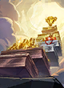 Trust Fund › 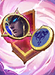 Astro Power's Badge ›  Legacy of Valor › 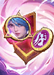 Starbelle's Badge ›  Fateful Dice ›  Payday ›  Quaking Blow ›  Prime Selection ›  Rock Solid ›  Uncertain Fortune ›  Healing Fountain

- **Luo Yi's Power** (Power): Langsung mendapatkan 1 Hero 3 Gold acak, lalu mendapatkan 1 Hero yang sama pada setiap awal babak, hingga total 6.
- **Trust Fund** (Ungu): Mendapatkan 8 / 16 / 25 Gold secara berurutan saat mencapai Commander level 8 / 9 / 10.
- **Astro Power's Badge** (Ungu): Mendapatkan Magic Crystal Astro Power dan Martis.
- **Legacy of Valor** (Ungu): Mendapatkan 1 Magic Crystal Faction dan dua hero Sinergi Faction ini secara acak (seharga 3 Gold dan 4 Gold).
- **Starbelle's Badge** (Ungu): Mendapatkan Magic Crystal Starbelle dan Miya.
- **Fateful Dice** (Ungu): Mendapatkan 1 Mirror Device.
- **Payday** (Ungu): Mendapatkan 7 Gold secara langsung dan 7 Gold pada setiap babak untuk 2 babak berikutnya.
- **Quaking Blow** (Ungu): Mendapatkan 1 Minotaur Bintang 3 dan memperkuat skill & atribut Minotaur.
- **Prime Selection** (Biru): Mendapatkan 1 Peti Magic Crystal. Pilih 1 dari 3 Magic Crystal acak.
- **Rock Solid** (Biru): Commander mendapatkan 20 Shield.
- **Uncertain Fortune** (Biru): Berpeluang 50% untuk mendapatkan 7 Gold, berpeluang 50% untuk mendapatkan 15 Gold.
- **Healing Fountain** (Biru): Memulihkan 3 HP Commander pada setiap babak dan mendapatkan 6 Gold.

### Build kamu: Odette ★2 sebagai Fan

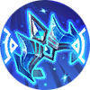 Winter Crown  Lightstick  Essence Core

| Sumber | Efek |
|---|---|
| **Essence Core (dari Lancelot ★2)** | +40% ATK Lancelot (+146), +40% HP (+2.934), item Essence Core +10% ATK & +10% HP. Role Phasewarper: +10% DMG, dan saat HP pertama kali < 40% pindah ke tempat aman & pulih 35% HP |
| **Lightstick** | +25% Hybrid ATK; Odette jadi Fan. Saat pertarungan mulai, Fan memberi bonus 50% (Starbelle 6) dari Hybrid ATK-nya ke dirinya dan semua hero Starbelle |
| **Winter Crown** | +10% ATK, +10% HP; saat HP < 25% atau terkena DMG mematikan: beku dan pulih 10% HP |
| **Mage 2** | +50% Magic ATK (40% hero Mage + 10% semua rekan) |
| **Astro 4 (Sovereign)** | +60% DMG dan 10% Lifesteal (Odette pegang item terbanyak) |

**Perkiraan hasil:**

- Odette ★2 dasar: ATK 265, HP 6.415. Perkiraan ATK sebelum bonus Fan ±801, setelah bonus Fan ±1.202 (Odette ★3 tanpa item: 565).
- Bonus Fan sekitar +401 Hybrid ATK ke setiap hero Starbelle: Fanny ★2 385 → ±786, Lolita ★2 260 → ±661, Edith ★2 205 → ±606, Miya ★2 165 → ±566, Zhuxin ★2 130 → ±531.
- HP Odette ±11.219 + Shield skill 1.300 + 2 kesempatan selamat (beku Winter Crown, pindah tempat Phasewarper).

### Kenapa kuat

- Lightstick didapat otomatis dari sinergi Starbelle. Bonusnya dihitung dari Hybrid ATK Fan saat pertarungan dimulai.
- Essence Core dari Lancelot ★2 (skill Luo Yi) menaikkan ATK dan HP Odette sekaligus memberi efek bertahan Phasewarper.
- Astro 4 menjadikan Odette Sovereign (+60% DMG). Mage 2 menambah +50% Magic ATK.
- Jalur kartunya mengambil Astro Power's Badge (crystal Astro + Martis), Starbelle's Badge (crystal Starbelle + Miya), Legacy of Valor, dan Prime Selection: semuanya sumber crystal di luar crystal Pilihan.

### Kelemahan

- Butuh dua hero 5 Gold ★2 (Odette, dan Lancelot untuk Essence Core): masing-masing 3 dari 9 stok, peluang toko 14% di level 9.
- Tanpa build Fan, Starbelle 6 sendiri hanya memberi 35 DEF.
- Shield skill Odette ★2 hanya 1.300; damage naga berbasis % Max HP (Dragoncaller) tetap berbahaya.

### Tips

- Pakaikan item cadangan ke Lancelot sebelum diubah: Essence Core juga mewarisi 40% atribut dasar equipment hero itu.
- Lancelot ★2 sudah pilihan terbaik untuk Essence Core (ATK ★2 tertinggi, 365, sama dengan Thamuz). Kalau Lancelot hanya ★1, Essence Core tetap memberi +96 ATK.
- Selesaikan item Odette sebelum babak dimulai: bonus Fan dihitung saat pertarungan mulai.

**Crystal yang dibutuhkan (tanpa ultra):** 1 crystal (Starbelle 6): crystal Pilihan, atau crystal dari Starbelle's Badge.

**Jalur ultra (opsional):** Starbelle 10 (tambah Cici; 6 hero + crystal Pilihan + 3 crystal Starbelle dari kartu Badge/Blessing, Legacy of Valor, atau creep IV-3): Mendapatkan 300 Hybrid DEF dan 200% Hybrid ATK. Fan memberikan bonus Hybrid ATK sebesar 100% dari nilai Hybrid ATK-nya yang lebih tinggi. Saat pertarungan dimulai, 3 sinar menyoroti chessboard, masing-masing mengurangi 10% Hybrid ATK semua lawan dan memberikan True DMG sebesar 12% Max HP mereka.

---

## #3 Kishin 6 + Phasewarper 3 + Shadeweaver 3 — Kagura

*Label in-game: S ("Pance kekebalan tubuh").*  Kishin 6  Phasewarper 3  Shadeweaver 3  Marksman 2

**Paling konsisten: dua sinergi sudah maksimal tanpa crystal, dan carry-nya punya HP efektif lebih dari 30.000.**

### Posisi papan

| K1 | K2 | K3 | K4 | K5 | K6 | K7 |
|---|---|---|---|---|---|---|
|   |   |   |   | 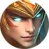 Hylos |  Franco |  Lancelot **C** |
|   |   |   |   |   |   |   |
|   |  Lunox |  Angela | 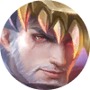 Clint | 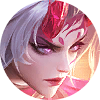 Karrie |  Kadita |  Melissa |

_C = carry, T = tank (target bintang dari layar Rekomendasi Lineup)._

### Commander  Kagura (Daya Tahan)

- **Lv 1+ Aktif: Shield Umbrella** — Selama Fase Persiapan, kamu bisa memilih Hero untuk mendapatkan Shield. Saat HP Hero tersebut berada di bawah 50% untuk pertama kali dalam pertarungan, Hero tersebut akan mendapatkan Shield sebesar 60% Max HP.
- **Lv 2+ Pasif: Yin Yang Gathering** — Nilai Shield meningkat menjadi 125% Max HP.
- **Kartu Power:** Pilih 1 Hero. Saat pertarungan dimulai, Hero tersebut mendapatkan 20% Hybrid Lifesteal dan 30% Hybrid ATK. Mendapatkan 9 Gold.

### Hero

| Hero | Harga | Sinergi | Peran |
|---|---|---|---|
|  **Hylos** | 2 Gold | Shadeweaver, Defender |  |
|  **Franco** | 3 Gold | Kishin, Dauntless, Weapon Master |  |
|  **Lancelot** | 5 Gold | Kishin, Phasewarper | C (kamu: ★2) |
|  **Lunox** | 4 Gold | Kishin, Stargazer |  |
|  **Angela** | 2 Gold | Kishin, Scavenger |  |
|  **Clint** | 3 Gold | Dragoncaller, Phasewarper |  |
|  **Karrie** | 4 Gold | Kishin, Marksman |  |
|  **Kadita** | 3 Gold | Shadeweaver, Mage, Phasewarper |  |
|  **Melissa** | 5 Gold | Shadeweaver, Marksman |  |

### Sinergi aktif

| Sinergi | Jumlah | Tingkat aktif | Efek (data game) |
|---|---|---|---|
|  **Kishin** | 6 (+1 crystal) | 6 → 10 | Mendapatkan 1 Equipment Kishin tambahan. Hero Kishin mendapatkan 36 Hybrid DEF. |
|  **Phasewarper** | 3 | 3 (maks) | 15% Peningkatan DMG; Memulihkan 50% HP |
|  **Shadeweaver** | 3 | 3 (maks) | Memberikan 50% ATK Speed dan menyebabkan airborne ke lawan selama 1 detik. |
|  **Marksman** | 2 | 2 → 4 | Semua rekan mendapatkan 5% ATK Speed. Hero Marksman mendapatkan 20% ATK Speed tambahan. |

### Go Go Card

 Kagura's Power ›  Purest Power Ⅱ ›  Uncertain Fortune

- **Kagura's Power** (Power): Pilih 1 Hero. Saat pertarungan dimulai, Hero tersebut mendapatkan 20% Hybrid Lifesteal dan 30% Hybrid ATK. Mendapatkan 9 Gold.
- **Purest Power Ⅱ** (Ungu): Ketika jumlah Sinergi yang aktif mencapai 6, Hero dengan Sinergi ini mendapatkan 28% Hybrid ATK.
- **Uncertain Fortune** (Biru): Berpeluang 50% untuk mendapatkan 7 Gold, berpeluang 50% untuk mendapatkan 15 Gold.

### Build kamu: Lancelot ★2 dengan 3 item Kishin Arcane

 Guren Chakram  Justice Sword 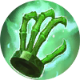 Nether Claw

| Sumber | Efek |
|---|---|
| **Guren Chakram (Arcane)** | +55% DMG, 20% Lifesteal, 20% Spell Vamp |
| **Justice Sword (Arcane)** | +20% Hybrid ATK; tiap 5 detik Rain of Swords memberi True DMG 20% ATK ke area dengan lawan terbanyak |
| **Nether Claw (Arcane)** | +20% Max HP, +50% HP; stun lawan di depan 2 detik |
| **Kishin 6 / Phasewarper 3** | +36 Hybrid DEF / +15% DMG, dan pulih 50% HP saat HP pertama kali < 40% |
| **Kagura** | Shield Umbrella Lv2: Shield 125% Max HP saat HP < 50%. Kagura's Power: +30% Hybrid ATK, +20% Lifesteal |
| **Purest Power Ⅱ** | +28% Hybrid ATK untuk hero Kishin (Kishin aktif di jumlah 6) |

**Perkiraan hasil:**

- Lancelot ★2 dasar: ATK 365, HP 7.335. Perkiraan ATK ±650 dan bonus DMG +70%.
- HP ±12.470 + Shield ±15.587 + heal ±6.235 = HP efektif ±34.291, plus Lifesteal 40% dan Spell Vamp 20%.
- Pembanding: hero 4 Gold ★3 punya HP sekitar 18.115; Lancelot ★3 50.535, tapi butuh seluruh 9 stok.

### Kenapa kuat

- Phasewarper 3 dan Shadeweaver 3 sudah tingkat maksimal hanya dengan 3 hero; Kadita dihitung di keduanya.
- Item Kishin naik tingkat dengan membeli duplikat hero Kishin di toko (maksimal Arcane). Ini soal Gold, bukan hoki.
- Shadeweaver: angin memberi +50% ATK Speed ke rekan di kolom yang ditempati hero Shadeweaver, dan membuat lawan airborne 1 detik.

### Kelemahan

- Semua bergantung pada satu carry. Lancelot ★2 butuh 3 dari 9 stok.
- Dua hero 5 Gold (Lancelot, Melissa) mahal.
- Lunox ★2 dinerf kecil di Penyesuaian 20/10 (Hybrid ATK 200 → 185); untuk Kishin 6 jumlah hero yang penting, bukan damage Lunox.

### Tips

- Ambil kartu Kishin Unbound kalau muncul: ketiga item jadi versi Diperkuat (Lifesteal/Spell Vamp 30%, ATK +40%, HP +40%) + 5 refresh gratis.
- Taruh Lancelot di kolom yang sama dengan hero Shadeweaver (di layout ini: satu kolom dengan Melissa).
- Pakai Shield Umbrella dan Kagura's Power ke Lancelot.

**Crystal yang dibutuhkan (tanpa ultra):** 1 crystal (Kishin 6) dari crystal Pilihan, atau tambah Dyrroth tanpa crystal.

**Jalur ultra (opsional):** Kishin 10 (tambah Dyrroth; 6 hero + crystal Pilihan + 3 crystal Kishin dari Kishin's Blessing/Badge, Legacy of Valor, atau creep IV-3): item naik ke Supreme. Guren: +150% DMG & +65% HP; Justice Sword: Giant Sword True DMG 500% ATK ke semua lawan di detik ke-3; Nether Claw: +200% HP & stun semua lawan 3 detik.

---

## #4 Astro 6 + Mage 4 — Minotaur

*Label in-game: S.*  Astro Power 6  Mage 4  Defender 2  Enchanted Tales 2  Starbelle 2  Stargazer 2

**Stabil dan kuat, tapi Odette hanya menguatkan dirinya sendiri, dan Astro paling sering diperebutkan.**

### Posisi papan

| K1 | K2 | K3 | K4 | K5 | K6 | K7 |
|---|---|---|---|---|---|---|
|   |  Karina | 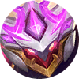 Atlas |  Odette **C ★★** |  Hilda **T ★★** |  Minotaur |   |
|   |   |   |   |   |   |   |
|  Vexana |  Zhuxin |   |   |   |  Irithel |  Gord |

_C = carry, T = tank (target bintang dari layar Rekomendasi Lineup)._

### Commander  Minotaur (Strategi)

- **Lv 1+ Aktif: Molten Decree** — Pilih Equipment untuk memperkuatnya. Bisa digunakan 3 kali. (Tidak berlaku untuk Equipment Khusus dan Equipment yang Diperkuat.)
- **Lv 2+ Pasif: Bloodline Resonance** — Mendapatkan 1 Peti Equipment. Mendapatkan 3 Gold untuk setiap Equipment yang diperkuat oleh skill.
- **Kartu Power:** Pilih Equipment untuk diperkuat. Bisa digunakan 2 kali. Mendapatkan 2 Equipment acak.

### Hero

| Hero | Harga | Sinergi | Peran |
|---|---|---|---|
|  **Karina** | 3 Gold | Astro Power, Swiftblade, Stargazer |  |
|  **Atlas** | 4 Gold | Enchanted Tales, Defender |  |
|  **Odette** | 5 Gold | Astro Power, Mage | C ★★ |
|  **Hilda** | 3 Gold | Astro Power, Dauntless | T ★★ |
|  **Minotaur** | 1 Gold | Astro Power, Defender |  |
|  **Vexana** | 4 Gold | Enchanted Tales, Mage |  |
|  **Zhuxin** | 2 Gold | Starbelle, Mage |  |
|  **Irithel** | 4 Gold | Astro Power, Marksman |  |
|  **Gord** | 4 Gold | SPECTRE, Mage |  |

### Sinergi aktif

| Sinergi | Jumlah | Tingkat aktif | Efek (data game) |
|---|---|---|---|
|  **Astro Power** | 6 (+1 crystal) | 6 → 10 | Mendapatkan 30% Peningkatan DMG. Astro Sovereign mendapatkan 90% Peningkatan DMG dan 15% Hybrid Lifesteal tambahan. |
|  **Mage** | 4 | 4 → 6 | Semua rekan mendapatkan 20% Magic ATK. Hero Mage mendapatkan 80% Magic ATK tambahan. |
|  **Defender** | 2 | 2 → 4 | Semua rekan mendapatkan 6 Hybrid DEF. Hero Defender mendapatkan 20 Hybrid DEF tambahan. |
|  **Enchanted Tales** | 2 | 2 → 4 | Setiap Tale Fragment memberikan 1.5% Peningkatan DMG. |
|  **Starbelle** | 2 (+1 crystal) | 2 → 4 | Mendapatkan 10 Hybrid DEF. Fan memberikan bonus Hybrid ATK sebesar 15% dari nilai Hybrid ATK-nya yang lebih tinggi. |
|  **Stargazer** | 2 (+1 crystal) | 2 → 4 | Semua rekan memulihkan 2 Mana setiap detik. Hero Stargazer memulihkan 6 Mana tambahan setiap detik. |

### Go Go Card

 Minotaur's Power ›  Golden Era+ › 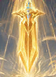 Divine Execution › 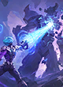 Critical Spellcraft ›  Starbelle's Badge ›  Stargazer's Badge ›  Astro Judgment › 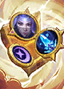 Stargazer's Blessing › 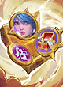 Starbelle's Blessing

- **Minotaur's Power** (Power): Pilih Equipment untuk diperkuat. Bisa digunakan 2 kali. Mendapatkan 2 Equipment acak.
- **Golden Era+** (Oranye): Mendapatkan 10 Refresh Toko gratis. Dapatkan 5 Refresh Toko gratis tambahan setiap kali menaikkan Level Commander.
- **Divine Execution** (Oranye): Saat rekan menyerang lawan dengan HP di bawah 16%, dia langsung mengeliminasi target tersebut dan memberikan 550 True DMG ke lawan di sekitar.
- **Critical Spellcraft** (Ungu): Skill Hero Mage berpeluang 60% untuk memberikan 150% DMG.
- **Starbelle's Badge** (Ungu): Mendapatkan Magic Crystal Starbelle dan Miya.
- **Stargazer's Badge** (Ungu): Mendapatkan Magic Crystal Stargazer dan Luo Yi.
- **Astro Judgment** (Ungu): Astro Sovereign meluncurkan Judgment Bolt ke setiap lawan yang terkena skill-nya, memberikan True DMG sebesar 160% Hybrid ATK. (Cooldown: 3 detik per lawan)
- **Stargazer's Blessing** (Oranye): Mendapatkan Magic Crystal Stargazer, Ice Queen Wand, dan Luo Yi.
- **Starbelle's Blessing** (Oranye): Mendapatkan Magic Crystal Starbelle, Peti Equipment, dan Miya.

### Kenapa kuat

- Odette mendapat bonus dua kali: Sovereign Astro 6 (+30% & +90% DMG, 15% Lifesteal) dan Mage 4 (+80% Magic ATK).
- Astro Judgment: setiap lawan yang terkena skill Sovereign mendapat True DMG 160% Hybrid ATK (cooldown 3 detik per lawan). Sangat cocok dengan tarian AoE Odette.
- Minotaur memperkuat 3 equipment dan memberi 3 Gold untuk setiap penguatan.
- Jalur kartunya mengambil Starbelle's Badge/Blessing dan Stargazer's Badge/Blessing: 4 crystal biasa (plus Miya, Luo Yi, Ice Queen Wand, Peti Equipment). Dari situlah Stargazer 2 dan Starbelle 2, karena crystal Pilihan sudah dipakai untuk Astro 6.

### Kelemahan

- Empat sinergi pengisi (Defender 2, Enchanted Tales 2, Stargazer 2, Starbelle 2). Stargazer 2 dan Starbelle 2 hanya aktif kalau kartu Badge/Blessing-nya muncul.
- Irithel tanpa item dan tanpa sinergi Marksman hanya menambah jumlah Astro.
- Astro diperebutkan (Hilda ada di 4 dari 8 lineup pada pertandingan 20 Oktober), dan lemah melawan Dragoncaller.

### Tips

- Variasi Mage 6 + Astro 6: ganti Irithel dan Atlas dengan Vale dan Kadita, lalu pasang crystal Pilihan Astro di Karina atau Hilda dan 1 crystal Astro dari Astro Power's Badge/Blessing.
- Pakai crystal Pilihan untuk Astro atau Mage, bukan Dauntless.
- Habiskan penguatan Minotaur lebih awal (setiap penguatan +3 Gold).

**Crystal yang dibutuhkan (tanpa ultra):** 1 crystal (Astro 6) dari crystal Pilihan; Stargazer 2 dan Starbelle 2 butuh 2 crystal lagi dari kartu Badge/Blessing.

**Jalur ultra (opsional):** Astro 10 (tambah Martis; 6 hero + crystal Pilihan + 3 crystal Astro dari Astro Power's Badge/Blessing, Legacy of Valor, atau creep IV-3): Mendapatkan 100% Peningkatan DMG. Satu Astro Sovereign tambahan akan muncul di antara hero Astro Power lainnya. Kedua Astro Sovereign mendapatkan 300% Peningkatan DMG, 40% Hybrid Lifesteal, dan 600% Max HP tambahan. Basic ATK mereka menciptakan Astro Link, memberikan True DMG sebesar 600% Adaptive ATK ke target dan 4 lawan di sekitar.

---

## #5 Dragon Altar 6 + Dragoncaller 4 — Kalea

*Label in-game: S.*  Dragon Altar 6  Dragoncaller 4  Bruiser 2  Defender 2  Stargazer 2  Swiftblade 2  Weapon Master 2

**Paling lemah tanpa ultra, tapi paling berbahaya kalau berhasil ultra Dragoncaller (seperti juara pertandingan 20 Oktober). Penyesuaian 20/10 melemahkan carry-nya (Badang ★2), jadi jarak ke lineup lain makin lebar.**

### Posisi papan

| K1 | K2 | K3 | K4 | K5 | K6 | K7 |
|---|---|---|---|---|---|---|
| 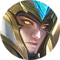 Zilong |  Yin |  Yi Sun-shin | 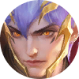 Gusion |  Badang **C ★★** | 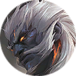 Baxia | 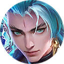 Suyou **T ★★★** |
|   |   |   |   |   |   |   |
| 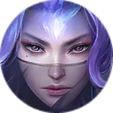 Luo Yi |   |   |   |   |   |  Eudora |

_C = carry, T = tank (target bintang dari layar Rekomendasi Lineup)._

### Commander  Kalea (Strategi)

- **Lv 1+ Pasif: Serpent's Favor** — Kalea memanggil Brankas Harta di sisi chessboard. Mulai dari Babak I-4, ketuk Dadu Keberuntungan setiap babak untuk mendapatkan 1–4 poin secara acak. Jika total melebihi 8 setelah lemparan, poin direset menjadi 0. Aktifkan Brankas untuk mengklaim Hadiah berdasarkan poin saat ini. Aktivasi maksimum per pertandingan: 2.
- **Lv 2+ Pasif: Wave of Fortune** — Jumlah aktivasi maksimum Brankas Harta ditingkatkan menjadi 3.
- **Kartu Power:** Langsung melempar Dadu Keberuntungan dan melemparnya lagi pada awal Fase Ⅲ untuk mendapatkan hadiah senilai total 21–35 Gold berdasarkan hasil lemparanmu.

### Hero

| Hero | Harga | Sinergi | Peran |
|---|---|---|---|
|  **Zilong** | 4 Gold | Dragoncaller, Weapon Master |  |
|  **Yin** | 4 Gold | Dragon Altar, Bruiser |  |
|  **Yi Sun-shin** | 1 Gold | Dragon Altar, Swiftblade |  |
|  **Gusion** | 4 Gold | Dragoncaller, Swiftblade |  |
|  **Badang** | 5 Gold | Dragoncaller, Bruiser | C ★★ |
|  **Baxia** | 5 Gold | Dragon Altar, Defender |  |
|  **Suyou** | 4 Gold | Dragon Altar, Weapon Master | T ★★★ |
|  **Luo Yi** | 2 Gold | Dragon Altar, Stargazer |  |
|  **Eudora** | 1 Gold | Dragoncaller, Stargazer |  |

### Sinergi aktif

| Sinergi | Jumlah | Tingkat aktif | Efek (data game) |
|---|---|---|---|
|  **Dragon Altar** | 6 (+1 crystal) | 6 → 10 | Mengubah semua petak menjadi petak khusus. Mendapatkan 16% Hybrid ATK dan HP. |
|  **Dragoncaller** | 4 | 4 → 6 | Naga turun untuk memberikan 10% Max HP sebagai DMG. Hero Dragoncaller mendapatkan 20% Peningkatan DMG. |
|  **Bruiser** | 2 | 2 → 4 | Mendapatkan 15% DMG Basic ATK tambahan. Berpeluang 20% untuk menyerang dua kali. |
|  **Defender** | 2 (+1 crystal) | 2 → 4 | Semua rekan mendapatkan 6 Hybrid DEF. Hero Defender mendapatkan 20 Hybrid DEF tambahan. |
|  **Stargazer** | 2 | 2 → 4 | Semua rekan memulihkan 2 Mana setiap detik. Hero Stargazer memulihkan 6 Mana tambahan setiap detik. |
|  **Swiftblade** | 2 | 2 → 4 | Semua rekan mendapatkan 10 Hybrid Penetration. Hero Swiftblade mendapatkan 25 Hybrid Penetration tambahan. |
|  **Weapon Master** | 2 | 2 → 4 | Semua rekan mendapatkan 5% Hybrid Lifesteal. Hero Weapon Master mendapatkan 5% Hybrid Lifesteal dan 40% Physical ATK tambahan. |

### Go Go Card

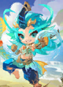 Kalea's Power › 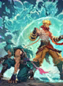 Valor's Embrace ›  Healing Fountain

- **Kalea's Power** (Power): Langsung melempar Dadu Keberuntungan dan melemparnya lagi pada awal Fase Ⅲ untuk mendapatkan hadiah senilai total 21–35 Gold berdasarkan hasil lemparanmu.
- **Valor's Embrace** (Ungu): Ketika ada rekan yang tereliminasi, Hero Dragon Altar mendapatkan Shield sebesar 8% Max HP-nya.
- **Healing Fountain** (Biru): Memulihkan 3 HP Commander pada setiap babak dan mendapatkan 6 Gold.

### Kenapa kuat

- Dragon Altar 6: semua petak jadi petak khusus; semua rekan +16% Hybrid ATK & HP, hero Dragon Altar 3 kali lipat (+48%).
- Dragoncaller 4: 3 naga × 10% Max HP lawan di area 3×3, hero Dragoncaller +20% DMG.
- Kalea untuk ekonomi: Brankas Harta 2–3 kali (hingga 19 Gold atau 9 Gold + hero 5 Gold); Kartu Power 21–35 Gold.

### Kelemahan

- Lima sinergi pengisi bernilai kecil. Dragon Altar 6 memakai crystal Pilihan; Defender 2 butuh crystal kedua dari kartu (acak).
- Suyou ★3 butuh 9 dari 14 stok. Valor's Embrace (Shield 8% saat rekan tereliminasi) lemah.
- Penyesuaian 20/10: peluang tinju balik Badang 50% → 25%, jadi DMG balasan Badang ★2 tinggal separuh (±72 per serangan yang diterima). Pengali ★3-nya naik, tapi Badang ★3 butuh seluruh 9 stok hero 5 Gold.

### Tips

- Tentukan satu jalur ultra sejak Fase II. Crystal Pilihan hanya satu yang aktif, jadi ultra butuh 3 crystal dari kartu Badge/Blessing, Legacy of Valor, atau creep IV-3.
- Jalur Dragoncaller paling mudah: tambah Balmond (2 Gold) dan Clint (3 Gold) untuk Dragoncaller 6, lalu crystal.
- Setelah 20/10 (saran, belum dites): taruh item damage di Zilong (Dragoncaller + Weapon Master; tiap 3 Basic ATK menyerang 3× 80% ATK dan memulihkan HP) dan beri Badang item bertahan. Badang ★2 tetap tebal di depan, tapi tidak lagi layak jadi pemegang item damage utama.

**Crystal yang dibutuhkan (tanpa ultra):** 1 crystal (Dragon Altar 6) dari crystal Pilihan; Defender 2 butuh 1 crystal lagi dari kartu (acak).

**Jalur ultra (opsional):** Dragoncaller 10 (6 hero + crystal Pilihan + 3 crystal Dragoncaller dari kartu/creep): Naga turun untuk memberikan 70% Max HP sebagai DMG. Hero Dragoncaller mendapatkan 200% Peningkatan DMG dan 60% HP. Pada awal pertarungan, memanggil Naga Suci yang menyerang untuk memberikan 50% Max HP sebagai DMG. Semua serangan naga bisa menyebabkan stun ke lawan selama 3 detik. — atau Dragon Altar 10 (tambah Wanwan): Mendapatkan semua efek dari Sinergi berjumlah 6. Mendapatkan 100% Hybrid ATK dan HP. Selain itu, seekor naga akan turun pada awal pertarungan, memberikan True DMG sebesar 50% HP lawan dan menyebabkan stun selama 3 detik.

---

## Pelajaran dari pertandingan 20 Oktober

- Pertandingan 20 Oktober 2026 (ID 374683366623511459): kamu (CinCoeg) peringkat 2 dengan Astro 6 + Mage 4 (Minotaur), menyerah di IV-4.
- Juara (MANIAC, level 10) sudah mencapai Dragoncaller 10, lalu menjual banyak hero di akhir; layar hasil hanya mencatat 7 hero dan Dragoncaller 6.
- Dragoncaller 10: Naga turun untuk memberikan 70% Max HP sebagai DMG. Hero Dragoncaller mendapatkan 200% Peningkatan DMG dan 60% HP. Pada awal pertarungan, memanggil Naga Suci yang menyerang untuk memberikan 50% Max HP sebagai DMG. Semua serangan naga bisa menyebabkan stun ke lawan selama 3 detik. Damage dihitung dari Max HP, jadi Defender, Dauntless, dan tank tebal tidak membantu.
- Pelajaran: begitu lawan terlihat menuju ultra (cek panel X/10 dan crystal di papannya), lihat apakah ultra-mu sendiri masih mungkin. Waktu itu kamu Astro 6/10: masih butuh Martis (+1) dan 3 crystal Astro lagi. Karena crystal Pilihan hanya satu yang aktif, ketiganya harus dari kartu Astro Power's Badge/Blessing, Legacy of Valor, atau creep IV-3, jadi ultra Astro memang butuh hoki. Crystal Dauntless di Odette lebih berguna sebagai Astro.

## Catatan data dan asumsi

- Sumber angka: S7.json versi game 1.3.24.344.1, Season 7 "Chrono Echoes", termasuk perubahan server Patch 7.2 dan Patch 20/10 (server_patch.json).
- Hero, sinergi, dan Go Go Card di screenshot Rekomendasi Lineup dikenali dengan mencocokkan potret ke ikon asli dari file game. Kartu Badge/Blessing di lineup Luo Yi dan Minotaur dikonfirmasi dari screenshot Rekomendasi Go Go Card.
- Aturan 1 crystal Pilihan aktif berasal dari pengalaman bermain; logikanya ada di kode client, bukan di tabel data.
- Angka build adalah perkiraan: semua bonus persen dianggap dijumlahkan dari ATK/HP dasar, karena urutan penumpukannya tidak tertulis di file game.
- File game tidak menyimpan win rate; peringkat ini teoretis dari angka game, ditambah pengalaman pertandingan 20 Oktober.
- Isi Toko Spirit Sand belum dicek ke screenshot toko.
